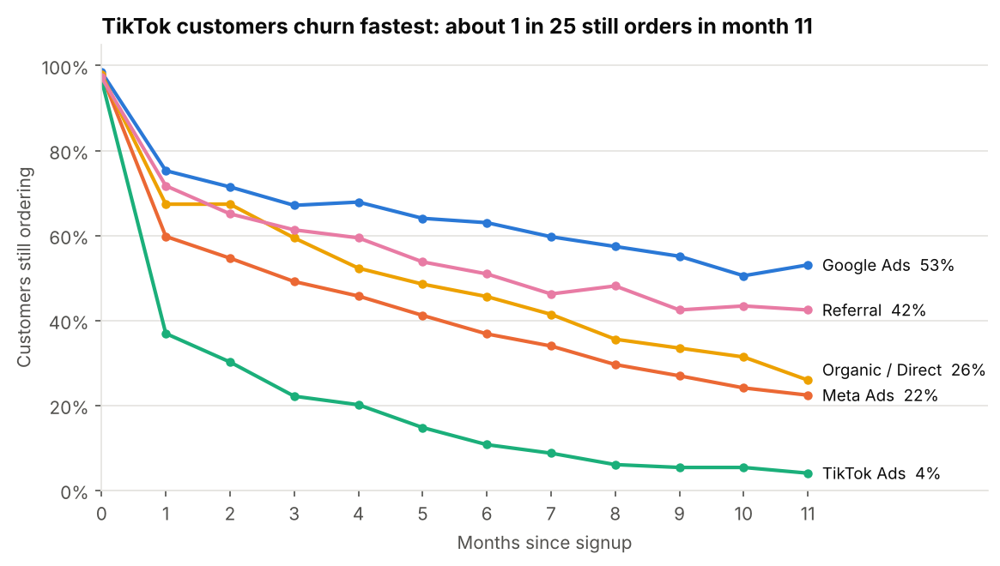
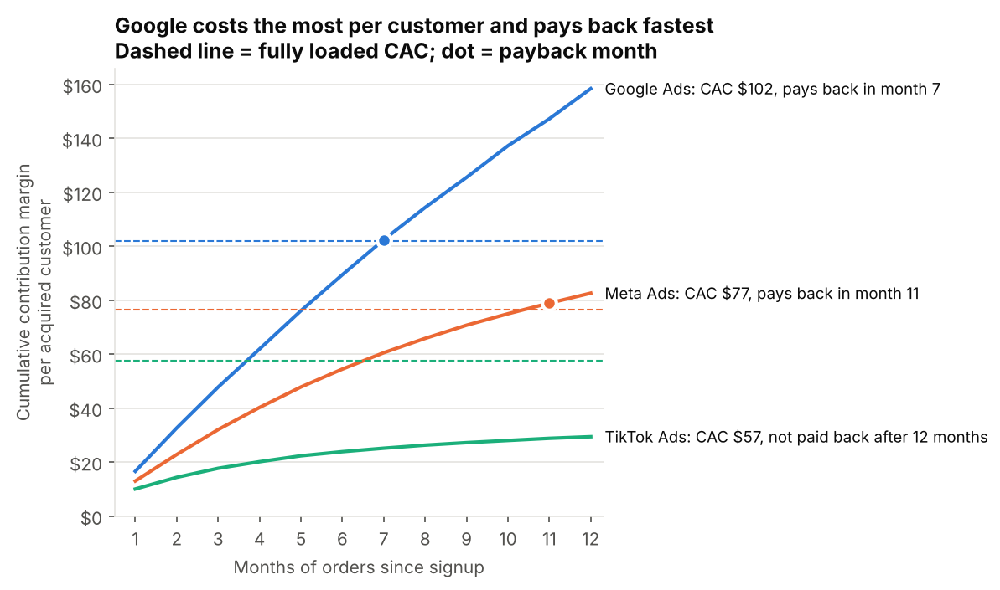
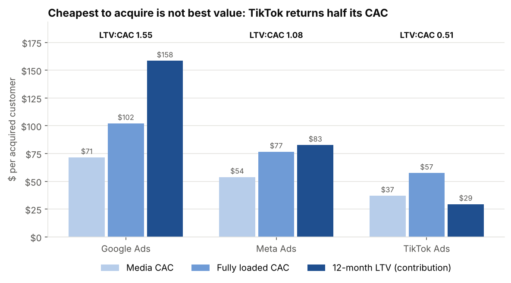
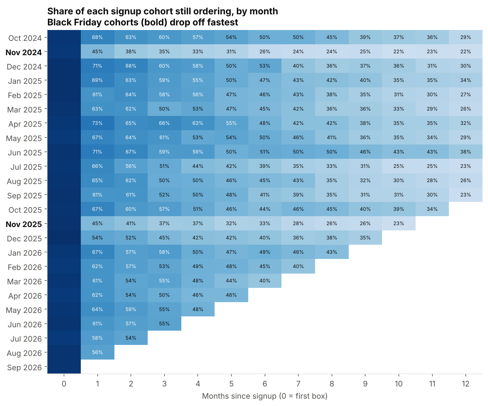

# Findings: which channel's customers actually pay for themselves?

**Short version:** the channel with the cheapest customers is the one losing money. TikTok acquires customers for $57 each, but they return $29 of contribution in their first year. Google costs $102 per customer and earns it back by month 7. Because budget has been moving toward TikTok on the strength of its CAC, the business now pays less for each new customer but gets much less back.

The data is synthetic (a fictional coffee subscription, Oct 2024 - Sep 2026, 3,262 customers, 16,974 orders), so treat the numbers as a worked example of the method, not a benchmark.

---

## The problem

Every ad platform reports cost per acquisition, and that is the number most budget conversations start from. For a subscription business it leaves out the part that matters most: how long each customer stays. Two channels can bring in customers at the same cost and still be worth very different amounts, because one channel's customers cancel after a box and the other's stay a year.

So the question here is not "which channel is cheapest?" but "which channel's customers pay back what we spent to get them, and how fast?"

## What I did

1. Loaded four raw exports into BigQuery: customers (with UTM tags), orders, the finance team's marketing ledger and the product cost sheet. Each had its own problems: duplicate customers with different ID formats, 22 source/medium labels for 5 channels (including `google / organic`, which must not count as Google Ads), test and cancelled orders, amounts stored as text, and three different month formats in the ledger.
2. Cleaned everything into one customer table, one order table and one spend table.
3. Worked out the contribution margin of every order: revenue after discounts and refunds, minus product cost, shipping and payment fees. LTV is built on this, not on revenue, so it can be set directly against CAC.
4. Grouped customers into monthly signup cohorts by channel and tracked each cohort month by month: how many were still ordering and how much contribution they had produced so far.
5. Calculated CAC two ways: media only, and fully loaded with agency fees and creative production.
6. Compared channels over the same 12-month window, using only the cohorts that had a full year of data (Oct 2024 - Sep 2025). Newer cohorts haven't had time to show their full value, and mixing them in would make recent channels look worse than they are.

The full pipeline is in `/sql` (BigQuery) and `/python` (pandas version that produces the charts). Both give the same results.

---

## Finding 1: retention depends heavily on where the customer came from

75% of Google customers order again in their second month, and 53% are still ordering in month 11. For TikTok it is 37% and 4%. Meta sits in between, and referral customers come close to Google's at no media cost.

## Finding 2: CAC and payback rank the channels in opposite order

| Channel | Media CAC | Fully loaded CAC | 12-month LTV | LTV:CAC | Payback |
|---|---|---|---|---|---|
| Google Ads | $71 | $102 | $158 | 1.55 | Month 7 |
| Meta Ads | $54 | $77 | $83 | 1.08 | Month 11 |
| TikTok Ads | $37 | $57 | $29 | 0.51 | Not within 12 months |

Google is the most expensive channel and the only one with a comfortable margin. Meta just about breaks even within the year. TikTok's curve is flattening at about half its CAC, so it is unlikely ever to pay back.

The fully loaded view matters too. On media cost alone TikTok's CAC is $37; adding the UGC creators who make its ads takes it to $57. A report built from ad platform data alone would never show that cost.

## Finding 3: the move into TikTok lowered CAC and lowered value faster

| Period | TikTok share of paid signups | Blended CAC | Expected 12-month LTV | LTV:CAC |
|---|---|---|---|---|
| Oct 2024 - Mar 2025 | 11% | $81 | $106 | 1.31 |
| Apr 2026 - Sep 2026 | 49% | $69 | $73 | 1.05 |

Recent cohorts are too young to measure their 12-month value directly, so expected LTV weights each channel's mature LTV by its share of signups. On a monthly marketing report this period looks like a success: CAC down 15%. Underneath it, the value of the average new paid customer is down 32%, and the paid program as a whole has gone from a 31% return on acquisition cost to roughly break-even.

## Finding 4: Black Friday customers are the least loyal of the year

The two November cohorts, acquired with 50% off the first box, are the lightest rows in the heatmap. Compared with cohorts from other months:

| | Month-1 retention | Month-6 retention | 6-month LTV |
|---|---|---|---|
| Black Friday cohorts | 45% | 30% | $29 |
| Other months | 65% | 45% | $67 |

Part of the gap is the discount itself (the first box earns half as much), but most of it is retention: a large share of these customers wanted one cheap box, not a subscription.

## Recommendations

1. **Stop scaling TikTok on CAC.** Pause further budget increases and cut back to a test budget until retention improves. At current numbers each new TikTok customer loses about $28.
2. **Give every channel a maximum CAC based on payback, not a single blended CAC target.** For example, with a 12-month payback rule, Google can carry a CAC up to about $158 and Meta up to about $83; TikTok would need a CAC under $29.
3. **Put incremental budget into Google first, and test how far it scales.** Its returns will fall as spend grows, so increase in steps and watch the CAC of each new step, not the average.
4. **Fix the TikTok offer before giving up on the channel.** Test landing on a smaller trial box or a quiz-led onboarding flow, and judge each test on month-1 retention, not on CAC.
5. **Redesign the Black Friday offer.** Test a smaller first-box discount, or move the discount to the second or third box so it rewards staying rather than trying once.
6. **Report payback every month.** Add "month-1 retention by channel" and "payback month by channel" to the regular marketing report so the next budget shift is judged on both sides of the equation.

## Limitations

- **Synthetic data.** The method is the point, not the specific values.
- **12-month horizon.** LTV stops at month 12. Google and referral customers who are still active would add more value beyond that, so the gap between channels is probably understated.
- **Contribution, not profit.** Contribution margin leaves out fixed costs such as salaries and rent. It is the right measure for comparing acquisition channels, not for overall profitability.
- **One channel per customer.** Each customer is credited to the channel in their signup UTM tags. Customers who saw a TikTok ad and later searched on Google count as Google. My [previous project](https://github.com/paolofelix/multichannel-attribution-roas) shows how much that kind of choice can shift credit between channels.
- **No halo effects.** If TikTok drives brand awareness that shows up as organic or Google brand signups, this analysis can't see it. A geo holdout test would measure it.

## What I'd do next with real data

- Extend LTV beyond 12 months with a simple retention-curve forecast, so younger cohorts can be valued too.
- Split the paid channels by campaign (prospecting vs brand vs retargeting) to find the profitable parts of Meta and TikTok.
- Run a holdout test on TikTok to measure any effect it has on organic and branded search signups.
