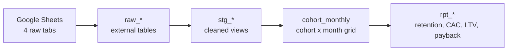
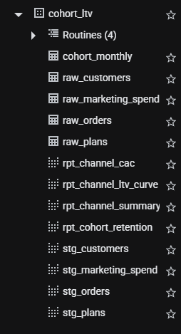
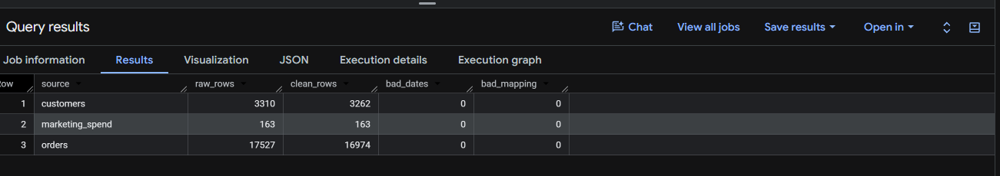
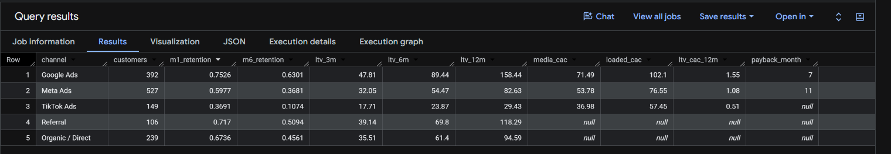

# Cohort LTV & CAC Payback by Acquisition Channel

[](https://paolofelix-cohort-ltv-cac-payback.streamlit.app/)

**▶ [Try the interactive dashboard](https://paolofelix-cohort-ltv-cac-payback.streamlit.app/)**: switch between media-only and fully loaded CAC, change the LTV horizon, and see which channels' customers pay back and when.

A BigQuery and Python pipeline that follows two years of subscription customers from their first order, by the channel that acquired them, and compares what each channel costs to acquire a customer (CAC) with what that customer earns back (LTV, on contribution margin).

**Key result:** TikTok has the lowest CAC ($57 fully loaded) but its customers return only $29 of contribution in their first year, about half of what they cost. Google costs the most per customer ($102) and is the only paid channel that clearly pays back, in month 7. Over the last 18 months the business moved budget into TikTok: blended CAC fell 15%, but the expected value of a new paid customer fell 32%.


📄 **[Read the findings write-up →](FINDINGS.md)** · 📊 **[Open the live dashboard →](https://paolofelix-cohort-ltv-cac-payback.streamlit.app/)** · **Tools:** BigQuery (SQL), Python (pandas, matplotlib, Plotly), Streamlit, Google Sheets

**Why synthetic data:** I analyze paid media accounts and their CRM and order data day to day, but client data is confidential. This dataset reproduces the problems I deal with in real CRM, order and finance exports: duplicate customer records, the same channel under 22 different source/medium labels, test and cancelled orders mixed in with real ones, amounts stored as text, and a finance ledger with three different month formats.

> **Part 2 of a marketing analytics series**
> 1. [Multi-channel attribution & ROAS](https://github.com/paolofelix/multichannel-attribution-roas): which channel gets credit?
> 2. **Cohort LTV & CAC payback**: what is a customer worth, and how fast does spend pay back?
> 3. [Marketing Mix Model](https://github.com/paolofelix/marketing-mix-model): what would have happened *without* each channel?
> 4. [Lead Scoring Model](https://github.com/paolofelix/lead-scoring-model): which leads will actually close, and which should sales call first?

---

## The business question

Ad platforms report cost per acquisition, so budget tends to flow to the channel with the cheapest new customer. For a subscription business that is only half the picture: a cheap customer who cancels after one box is worth less than an expensive one who stays a year.

So for each acquisition channel: **how long does it take to earn back what we paid for a customer, and does it ever?**

## Data

Synthetic data for a fictional DTC coffee subscription (monthly box, three plans), built to look like real exports, including the problems you see in practice (Oct 2024 - Sep 2026):

| Table | Rows | Description | Data issues built in |
|---|---|---|---|
| `customers` | 3,310 | One row per signup, with UTM source / medium / campaign | Duplicate customers with different ID formats (`c00123 `), dates in 3 formats, 22 source/medium labels for 5 channels, `google / organic` mixed in with `google / cpc` |
| `orders` | 17,527 | One row per monthly box | Amounts as text (`$45.00`, `45`), blank discounts, 10 spellings of 3 statuses, test orders, duplicate rows from overlapping exports |
| `marketing_spend` | 163 | Finance ledger: spend by month, channel and cost category | Months as `2025-03`, `Mar-2025` and `3/1/2025`, channel names in 9 spellings, platform credits as negative rows, non-acquisition software costs |
| `plans` | 3 | Price, cost of goods and shipping per box | Plan IDs in mixed case across tables |

## Pipeline



| Step | File | What it does |
|---|---|---|
| 1 | `01_external_tables.sql` | Reads the Google Sheet into BigQuery as external tables (all text) |
| 2 | `02_udfs.sql` | Reusable functions to parse numbers, dates and ledger months, and to map UTM source/medium to a channel |
| 3 | `03_staging.sql` | Dedupes customers and orders, removes test and cancelled orders, calculates net revenue and contribution margin per order, cleans the spend ledger |
| 4 | `04_data_quality_checks.sql` | Raw vs clean row counts and parse-failure checks |
| 5 | `05_cohort_model.sql` | Builds a cohort x month grid (signup month x channel x months since signup) with active customers, revenue, contribution and running LTV |
| 6 | `06_reporting_views.sql` | Retention triangle, CAC by channel and month (media only and fully loaded), LTV curves, and one summary row per channel with LTV:CAC and payback month |
| 7 | `07_channel_comparison.sql` | Channel comparison, budget-shift analysis and Black Friday cohort check |



## Definitions

- **Cohort:** customers who placed their first order in the same month, split by acquisition channel.
- **Contribution margin:** net revenue − cost of goods − shipping − 3% payment processing. Refunded boxes keep their cost but earn nothing. LTV is measured on contribution, not revenue, so it can be compared directly with CAC.
- **LTV (3 / 6 / 12 months):** cumulative contribution per acquired customer after that many monthly orders. Only cohorts that have reached the full horizon are included: the 12-month view uses the Oct 2024 - Sep 2025 cohorts, so every channel is measured over the same window.
- **CAC:** media CAC = ad spend ÷ new customers. Fully loaded CAC adds agency fees and creative production. Software (the email platform) is excluded.
- **Payback month:** the first month in which cumulative contribution per customer covers fully loaded CAC.

Window functions handle the running totals, `GENERATE_ARRAY` + `UNNEST` builds the full cohort grid (so months with zero orders still show up), and `QUALIFY ROW_NUMBER()` removes duplicates.

## Data quality

Every source loads with zero parse failures and zero unmapped channels. 48 duplicate customer rows, 18 test orders, 173 duplicate order rows and 362 cancelled orders are removed in staging.



## Results

Cohorts Oct 2024 - Sep 2025, 12 full months each:

| Channel | Customers | Month-1 retention | Media CAC | Fully loaded CAC | 12-month LTV | LTV:CAC | Payback |
|---|---|---|---|---|---|---|---|
| Google Ads | 392 | 75% | $71 | $102 | $158 | 1.55 | Month 7 |
| Meta Ads | 527 | 60% | $54 | $77 | $83 | 1.08 | Month 11 |
| TikTok Ads | 149 | 37% | $37 | $57 | $29 | 0.51 | Not within 12 months |
| Organic / Direct | 239 | 67% | - | - | $95 | - | - |
| Referral | 106 | 72% | - | - | $118 | - | - |




## What this means for budget

- **The CAC ranking is upside down.** Ranked by CAC, TikTok is the best channel and Google the worst. Ranked by what a customer returns, it is the other way round.
- **TikTok customers churn almost immediately.** 63% don't place an order in their second month, and 4% are still ordering in month 11. At $57 per customer and $29 of first-year contribution, every TikTok signup loses about $28.
- **The budget shift is quietly destroying value.** TikTok went from 11% to 49% of paid signups. Blended CAC fell from $81 to $69, which looks like a win in a monthly report, but the expected 12-month value of a paid customer fell from $106 to $73 and LTV:CAC from 1.31 to 1.05.
- **Black Friday cohorts are the weakest of the year.** The 50%-off first box brings in about 1.5x the usual number of signups, but 6-month LTV is $29 vs $67 for other months.
- **Recommendation:** stop scaling TikTok on CAC. Set a maximum CAC per channel from its payback curve, move incremental budget toward Google first (and test where its returns start to fall), hold Meta near break-even, and test a smaller Black Friday discount or a discount on the second box instead of the first.

*Note: the data is synthetic, so the absolute values are not benchmarks. The point is the method: comparing channels on payback instead of CAC.*

## Python version and charts

`python/cohort_ltv_charts.py` rebuilds the same pipeline in pandas from the CSVs in `/data`, prints the same tables as `07_channel_comparison.sql`, and saves the charts below.


To run it: `pip install -r python/requirements.txt`, then `python python/cohort_ltv_charts.py` from the repo root. Or open Google Colab and run:

    !git clone https://github.com/paolofelix/cohort-ltv-cac-payback.git
    %cd cohort-ltv-cac-payback
    !python python/cohort_ltv_charts.py

## Interactive dashboard

**Live app:** https://paolofelix-cohort-ltv-cac-payback.streamlit.app/

`dashboard/app.py` is a Streamlit app built on the same cleaning, contribution-margin and cohort logic as the SQL and Python pipeline. It recalculates live, so you can change the assumptions and see how the channel ranking holds up:

| Tab | What you can do |
|---|---|
| **CAC vs LTV** | Compare media CAC, fully loaded CAC and LTV for each paid channel, with LTV:CAC and a summary table for all five channels |
| **Payback curves** | Follow cumulative contribution per customer against CAC and see the month each channel pays back |
| **Retention** | Compare retention curves by channel and explore a cohort heatmap of retention or cumulative LTV for any channel |
| **Max CAC calculator** | Pick the payback period finance will accept and see the most each channel can pay per customer |
| **Budget shift** | See how the move into TikTok changed the paid signup mix, blended CAC and expected LTV per customer |
| **Black Friday cohorts** | Compare signups, retention and 6-month LTV for the 50%-off November cohorts against other months |
| **Data quality** | Check raw vs clean row counts, removed test, duplicate and cancelled orders, and how 22 UTM labels map to 5 channels |

The sidebar controls let you choose the CAC basis (fully loaded or media only), the LTV horizon (3, 6 or 12 months) and which channels to show. The defaults reproduce the numbers in this README.

To run it locally (from the repo root):

    pip install -r dashboard/requirements.txt
    streamlit run dashboard/app.py

## How to reproduce

1. Copy the 4 CSVs in `/data` into a Google Sheet, one tab each, using the same tab names.
2. In BigQuery (the free sandbox works), run `01_external_tables.sql` after replacing `YOUR_SHEET_ID` with your sheet's ID.
3. Run the remaining files in order (02 → 07). Run `05_cohort_model.sql` as one script (it declares a variable).
4. `04_data_quality_checks.sql` should return 3,262 customers, 16,974 orders and 163 spend rows with zero parse failures.

## Repository structure

```
├── README.md
├── FINDINGS.md        # plain-language write-up of results
├── sql/               # 7 BigQuery SQL files, run in order
├── python/            # pandas version, requirements.txt and charts/
├── data/              # synthetic source data (CSV)
└── screenshots/       # BigQuery query results
├── dashboard/         # Streamlit app (app.py) and its requirements.txt
├── .streamlit/        # dashboard theme (config.toml)
```

## About me

Paolo Felix: Data analyst with a background in financial operations and paid media analytics across Google, Meta and Microsoft Ads.
https://www.linkedin.com/in/paolo-stefano-b-felix/ · paolobfelix@gmail.com
